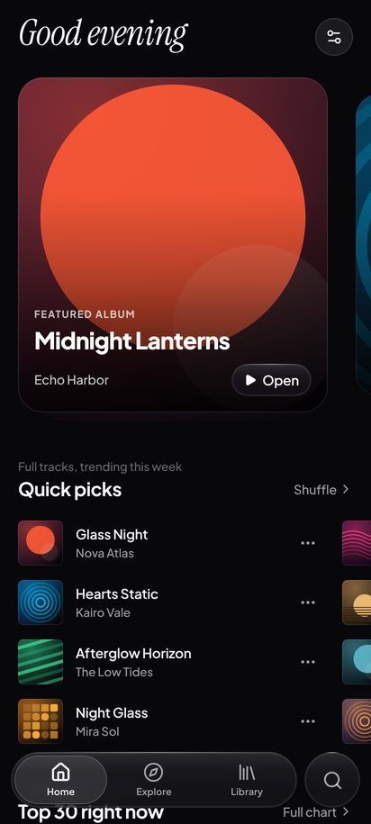
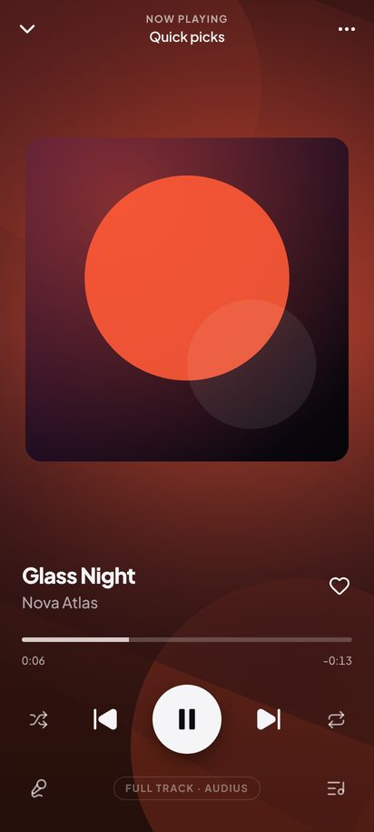
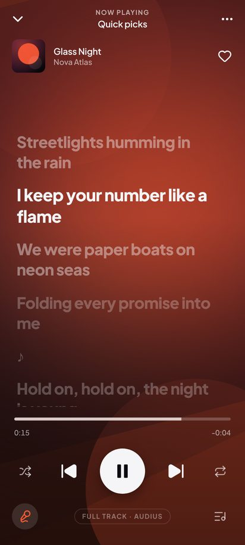
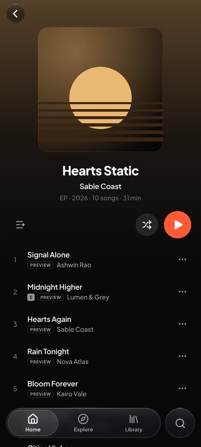

# Aura — a liquid-glass music player

A streaming-style music app for Android (React Native / Expo) with a separate, hardened Node.js backend.
Full-length tracks from independent artists, chart previews, synced lyrics, playlists and a library that
follows you between devices — wrapped in an Apple-Music-meets-Spotify interface built from frosted glass,
living artwork and spring physics.

<p align="center">
  
  
  
  
</p>

<sub>Screenshots use the offline demo server (fictional artists, generated cover art).</sub>

## What's inside

| | |
|---|---|
| **`mobile/`** | Expo SDK 58 · React Native 0.88 (New Architecture) · Expo Router · Reanimated 4 · Gesture Handler 3 · Skia · expo-audio (ExoPlayer) · expo-file-system · TanStack Query · Zustand · own tag reader + a small Kotlin module for the audio route |
| **`backend/`** | Node 22 · Express 5 · TypeScript · Zod · Argon2id · JOSE JWTs · MongoDB (or in-memory) · Groq (optional AI identification) · Vitest |
| **`docs/`** | Everything: setup, architecture, API, security, design system, your own music & AI lyrics, audio quality, building the APK |
| **`.github/workflows/`** | Builds a signed release **APK** on every push, runs backend tests |

## Highlights

- **Real Liquid Glass on Android** — our own GPU lens (RenderNode + AGSL shader): edge refraction, chromatic dispersion and specular rims like iOS 26, redrawn only when the page under it changes. A Settings slider sweeps every glass surface from clear Liquid Glass through Frosted to Opaque, live under your finger.
- **Floating glass dock** — floating tab dock with a sliding glass lens that shrinks to a single circle as you scroll (iOS 26 style), a glass mini player that **morphs** into the full player with a shared-element cover.
- **Living artwork** — the player background is the cover, blurred and slowly orbiting (Skia, rendered at ⅕ resolution for ~4% of the GPU cost), tinted by a palette extracted on-device.
- **Synced lyrics** — LRCLIB lyrics that follow the song line by line, tap any line to jump there.
- **Your own music, with lyrics** — add FLAC, WAV, MP3, M4A, OGG or Opus files or whole folders from your phone. Aura reads their tags, cover art and embedded lyrics itself, works out which song each file is (tags → file name → **Groq AI**, or by **listening** to a 20-second clip with Whisper) and fetches synced lyrics ([docs/LOCAL_MUSIC.md](docs/LOCAL_MUSIC.md)).
- **Play on your TV, speaker or receiver** — a Spotify-style *Play on* picker for Google Cast (Chromecast, Google TV, Nest, Cast TVs) and DLNA receivers / speakers (Yamaha MusicCast, HEOS, smart TVs…). The untouched original file goes over Wi-Fi; queue, seek and volume all work, and MusicCast receivers get a full remote: power, input, Pure Direct, sound programs, zones ([docs/DLNA.md](docs/DLNA.md)).
- **Sound like a hi-fi app** — 32-bit float output that keeps 24-bit files intact, a 10-band EQ with presets and AutoEq headphone correction (~8 800 models), ReplayGain (track/album), 5.1 → stereo downmix, and bit-perfect playback to USB DACs on Android 14+ ([docs/SOUND.md](docs/SOUND.md)).
- **Audio quality you can see** — Hi-Res / Lossless / bitrate badges for every song, and a Poweramp-style *How it’s playing* sheet: file (codec, bit depth, sample rate, encoder) → decoder → Android mixer → your output (wired, USB DAC, Bluetooth…), with honest verdicts ([docs/AUDIO_QUALITY.md](docs/AUDIO_QUALITY.md)).
- **Light & dark** — System / Light / Dark appearance; the player always keeps its artwork-tinted dark look.
- **Real streaming** — Audius full tracks (free, artist-owned), Deezer chart previews, optional Jamendo. Pluggable providers so you can drop in your own source later ([docs/PROVIDERS.md](docs/PROVIDERS.md)).
- **Background playback & lock-screen controls** — native queue with next/previous from the notification.
- **Guest-first library** — likes, playlists and history work without an account and sync when you sign in.
- **Secure by default** — Argon2id, rotating refresh tokens with theft detection, Keystore-backed token storage, https-only builds, rate limits, SSRF guard, strict validation ([docs/SECURITY.md](docs/SECURITY.md)).

## Get the APK

1. Deploy the backend (free on Render — [docs/DEPLOYMENT.md](docs/DEPLOYMENT.md)) and copy its https URL.
2. In GitHub: **Settings → Secrets and variables → Actions → Variables → `API_URL`** = that URL.
3. **Actions → Android APK → Run workflow.** When it finishes, download the APK from the
   [**latest release**](../../releases/tag/latest) and open it on your phone.

You can also change the server inside the app at any time: **Settings → Server**.
Full details, local builds and signing: [docs/BUILD_APK.md](docs/BUILD_APK.md).

## Run it locally (5 minutes)

```bash
# 1 — backend (real music sources)
cd backend && npm install && cp .env.example .env && npm run dev
#    …or the offline demo with fictional data:
npm run demo

# 2 — mobile (needs a dev build because of native modules)
cd ../mobile && npm install
EXPO_PUBLIC_API_URL=http://<your-LAN-IP>:4000 AURA_ALLOW_CLEARTEXT=true npx expo run:android
```

See [docs/GETTING_STARTED.md](docs/GETTING_STARTED.md).

## Documentation

- [Getting started](docs/GETTING_STARTED.md)
- [Architecture](docs/ARCHITECTURE.md)
- [API reference](docs/API.md)
- [Security](docs/SECURITY.md)
- [Design system & inspiration](docs/DESIGN.md)
- [Mobile app internals](docs/MOBILE.md)
- [Your own music + AI lyrics (Groq)](docs/LOCAL_MUSIC.md)
- [Audio quality & signal path](docs/AUDIO_QUALITY.md)
- [Sound: EQ, ReplayGain, 24-bit, bit-perfect USB](docs/SOUND.md)
- [Play on TVs, speakers & receivers (DLNA, Google Cast, MusicCast)](docs/DLNA.md)
- [Music providers / plugging in your own catalogue](docs/PROVIDERS.md)
- [Deployment](docs/DEPLOYMENT.md)
- [Building the APK](docs/BUILD_APK.md)
- [Troubleshooting](docs/TROUBLESHOOTING.md)

## Legal note

Aura streams only from sources that permit it: Audius (artists publish for free streaming), Deezer's public
30-second previews, Jamendo (Creative Commons) and LRCLIB (community lyrics). Artwork and music belong to
their owners. If you add another source, make sure you have the rights to stream it.
