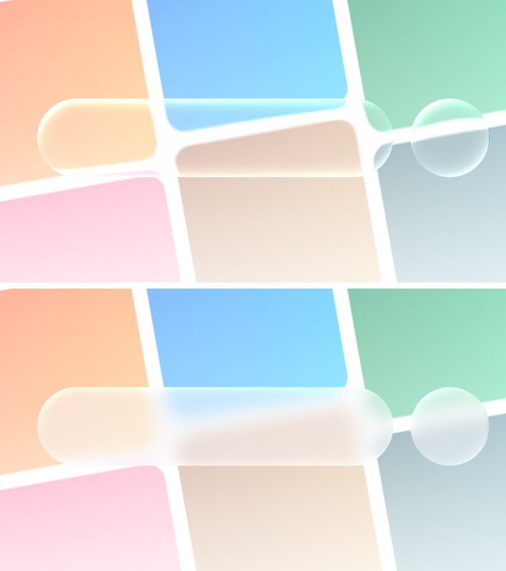

# Design system

## Direction

**Content-first darkness, wrapped in liquid glass.** The interface is near-black so album art is the
only real colour (Spotify's principle). Floating controls are frosted, rim-lit glass that lets that
colour bleed through (Apple's iOS 26 Liquid Glass). Motion is physical — springs, not tweens — and
always on the UI thread.

### Inspirations and what we took

| Source | Taken |
|---|---|
| **Apple Music (iOS 26)** | Floating glass tab bar that minimises on scroll; mini player attached to it; full player with the cover shrinking when paused; living blurred-artwork background; lyrics where the active line is bright and the rest recede; title marquee |
| **Spotify** (via `awesome-design-md/spotify`) | Near-black surfaces `#08080B`–`#1C1C24`; album art as the colour source; pill & circle geometry; bold/regular weight binary; heavy shadows only where something floats; "Jump back in" grid |
| **liquid-glass-js** | The glass layer model: blur → tint → edge rim brighter at the top → specular sheen; edge "lip" highlight. Re-implemented natively with one blur + two gradients (no per-frame shaders) |
| **taste-skill** | Restraint: one system (one button pair, one radius scale, one press interaction), no fade-in-on-scroll, a single entrance moment, 44 dp targets, contrast, reduced-motion respected, **no violet** |
| **YouTube Music** | Quick picks: paged columns of four rows |
| **Editorial music press** | Instrument Serif italic for greetings and chart numerals, as a counterpoint to the tight grotesk |
| **Apple design-md** | Negative letter-spacing on large titles; chrome that recedes; one interactive colour |

## Tokens (`mobile/src/theme`)

**Colour**

| Token | Value | Use |
|---|---|---|
| `bg` | `#08080B` | App background |
| `surface` / `surfaceHigh` | `#15151B` / `#1C1C24` | Placeholders, cards |
| `text` | `#F5F5F7` | Primary text |
| `textSecondary` / `Tertiary` | 64% / 40% white | Metadata, hints |
| `accent` | `#FF5A36` ("ember") | Things you can act on: play buttons, active states, current track |
| `glassTint` | `rgba(22,22,28,0.52)` | Over blur |
| `success` / `danger` / `warning` | `#3DDC97` / `#FF6B6B` / `#FFB13B` | Feedback only |

**Light theme** (`lightColors`, Settings → Appearance: System / Light / Dark) — white `#FFFFFF`
background, `#0B0B0F` text with 62 / 44 % secondary/tertiary, ink-tinted fills instead of white ones,
ember accent nudged to `#F04824` for contrast on white, light blur tint and a bright glass rim. Styles are
written once as `makeStyles((colors) => …)` and cached per palette. The **full player stays dark** in
light mode (`<ThemeScope scheme="dark">`): it sits on artwork colour, and the lyrics read best light-on-dark.

The player and detail pages add **dynamic colour** extracted from the cover on-device
(`lib/palette.ts`): `dominant`, `vibrant`, `dark` (safe under white text) and `light`.

**Type** — Plus Jakarta Sans (400–800) for UI; Instrument Serif Italic for display moments.

| Variant | Size/Line | Weight | Tracking |
|---|---|---|---|
| `display` | 44/48 | serif italic | −0.5 |
| `largeTitle` | 32/38 | 800 | −1.0 |
| `title1` | 26/32 | 800 | −0.7 |
| `title2` | 21/27 | 700 | −0.45 |
| `title3` | 17/22 | 700 | −0.25 |
| `headline` | 15/20 | 600 | −0.15 |
| `body` | 15/21 | 500 | −0.1 |
| `caption` | 13/17 | 500 | 0 |
| `label` | 11/14 | 700 caps | +1.1 |
| `lyric` | 28/36 | 800 | −0.6 |

**Spacing** 2·4·8·12·16·20·24·32·48, page gutter **20 dp**.
**Radius** 6 · 10 · 14 · 20 · 28 · 36 · pill.

**Motion** (`theme/motion.ts`)

| Spring | damping/stiffness | For |
|---|---|---|
| `snappy` | 22 / 320 | Press feedback, toggles |
| `sheet` | 28 / 240 | Player and bottom sheets (velocity-aware release) |
| `smooth` | 30 / 200 | Dock collapse, panel switches |
| `liquid` | 18 / 260 | Tab lens travel (with a brief 14% stretch) |

Press = scale to 96.5% on a spring, everywhere (`PressableScale`). Haptics only on meaningful
actions (play/pause, like, tab switch, success/error).

## Signature components

**Glass** (`components/ui/Glass.tsx`) — `overlay` variant blurs the real content beneath (Android 12+
RenderNode blur via `BlurTargetView`), `inline` variant (inside scroll views) uses a frosted fill on
Android to avoid recursive blur.

**Liquid Glass engine (Android 13+): Haze** — `mobile/modules/aura-liquid-glass` → `HazeGlassView`.
Glass is drawn by [Haze](https://github.com/chrisbanes/haze) 2.1 (`haze-glass` +
`haze-glass-material3`): refraction with a squircle surface profile, depth blur, specular highlight,
ambient edge (Fresnel) response, edge shadow and chromatic aberration, styled with
`GlassStyle.clear` / `GlassStyle.regular` + `.material3()` (Material 3 surface from Aura's theme).
Haze is Jetpack Compose, so each glass surface hosts a small `ComposeView`: one box marked
`hazeSource` draws the page behind it — the `RenderNode` expo-blur's `BlurTarget` already records,
shifted under the glass and padded 24 dp on every side so the rim has real content to bend — and a
second box applies `Modifier.hazeGlass(HazeInput.Sources(state), style)`. The Glass slider maps onto it:
Clear style at the liquid end, Regular past ~⅓, blur radius / refraction / dispersion / specular
following `lens(level)`, and Aura's material tint taking it on to frosted and opaque. Settings →
**Haze glass** switches back to Aura's own lens below. Requires Kotlin 2.3.20+ (set through
`expo-build-properties`; Haze is built with 2.4, which a 2.3 compiler can read, and 2.3.20 is the newest
version Expo's `pika` compiler plugin is published for).

**Aura lens (fallback, Android 12+)** — `LiquidGlassView` in the same module, our own GPU lens.

The page is already recorded into a `RenderNode` by expo-blur's `BlurTarget` (a display list, not
pixels). Each glass view re-records one tiny display list that draws that node shifted under itself
and lets RenderThread apply `RenderEffect.blur → AGSL RuntimeShader`. The shader computes the rounded
rectangle's signed distance field, bends the backdrop along a circular lens profile near the rim
(refraction), shifts R/G/B by slightly different amounts (dispersion), and adds a key + fill specular
rim — the iOS 26 look — then the result is clipped by an anti-aliased outline. It only redraws when
the page under it changed (`BlurTarget.isDirty`) or the glass moved (pre-draw position check): no
bitmaps, no software capture, no per-frame allocations.

| Android | What you get |
|---|---|
| 13+ (API 33) | Haze Material 3 Glass (or Aura's lens: blur + refraction + dispersion + specular rim) |
| 12 (API 31–32) | GPU blur through the same pipeline |
| ≤ 11 | Frosted fill (JS) |

Glass over the open full player and glass inside scrolling content (`variant="inline"`) stay frosted:
they'd have to sample content they're part of.

*Why not a library?* We evaluated the React Native options (Nov 2026):
[react-native-liquid-glassmorphism](https://github.com/himanshu-lal4/react-native-liquid-glassmorphism)
captures the view tree with a software `rootView.draw()` per glass view per frame (expensive with a
dock + mini player + sheets on screen);
[react-native-android-liquid-glass](https://github.com/sssajjad007/react-native-liquid-glass-android)
(QWEA0) only refracts siblings under the same parent and targets RN 0.85;
[@uginy/react-native-liquid-glass](https://github.com/uginy/react-native-liquid-glass) is API 33+ only
with no fallback. Kyant's [AndroidLiquidGlass / Backdrop](https://github.com/Kyant0/AndroidLiquidGlass)
is excellent but Jetpack Compose only. Reusing the display list expo-blur already records gives the
same optics with the lowest cost.

**Glass material dial** (Settings → Look & feel → Glass) — one continuous slider from **Liquid Glass**
(0) through **Frosted** (0.5) to **Opaque** (1), with soft magnetic detents and a haptic tick at each.
`lib/glassMaterial.ts → material(level)` turns the level into every layer's strength:

| Layer | Liquid Glass → Frosted → Opaque |
|---|---|
| Material tint (`glassBase`) | 8 % with the native lens (36 % with plain blur) → ~58 % → 100 % opaque (≥ 86 % where Android can't blur) |
| Native lens (`lens(level)`) | blur 1.5 → ~18 dp, refraction 1 → ~0.4 → 0, dispersion 0.45 → 0, specular 1 → 0.3 |
| Blur intensity | ×0.85 → ×1.75 (frosted blurs more), unmounted from 97 % up |
| Top sheen, top lip | full → faint → off |
| Bottom refraction glow | full → off by ~45 % (the "liquid" cue) |
| Edge rim | 100 % → 45 % |

The level lives in a UI-thread shared value (`lib/glass.ts → glassLevel`), so dragging re-tints the
dock, mini player, sheets and toasts live at frame rate without React re-renders; the setting is saved
on release and blur intensity re-quantises then. Text-heavy surfaces set a floor (`minTint`: sheets
0.62, toasts 0.55) so liquid glass never costs legibility. A Skia preview above the slider (drifting
shapes behind a real backdrop-blurred card) uses the same curve. The old on/off "Reduce transparency"
setting is migrated: on → Opaque, off → Liquid Glass.

**Glass dock** — tab pill + search circle. A glass lens slides between tabs with a liquid stretch.
Scrolling down collapses the pill into a single circle and slides the mini player down beside it;
scrolling up restores it.

**Player sheet** — one continuous surface driven by a single shared value `p` (0 = mini, 1 = full):
frame, corner radius, glass ↔ living background cross-fade and content opacity all interpolate from
`p`. The cover is a separate shared element that flies from the mini thumbnail to the hero position
(and to a small header thumb when lyrics/queue are open). Drag the mini up or the full player down;
release velocity decides where it lands.

**Living background** — Skia canvas at ⅕ screen size: two huge blurred copies of the cover orbiting
plus two palette blobs, scaled up 5× by the GPU. Stops animating when the player is closed or
reduce-motion is on.

**Lyrics** — active line computed on the UI thread by binary search over line times; lines animate
opacity/scale; auto-scroll keeps the active line ~30% from the top and pauses for 3.5 s after you
scroll manually; tap a line to seek. A pulsing "• • •" fills long intros.

**Quality badge** — the player's bottom-bar chip: gold `HI-RES 24/96` for hi-res lossless,
`LOSSLESS 16/44.1`, or a plain `MP3 320`. Tapping it opens the **Audio quality** sheet: a tier header
with a 5-bar meter, a vertical *How it's playing* stepper (file → decode → mixer → output) whose dots
use `success` / `warning` / `danger` for clean / compromise / lossy, a verdict card and a details grid.
Lists show a tiny `HI-RES` / `LOSSLESS` tag, styled like the preview tag. Gold is the only extra hue and is
reserved for Hi-Res. See [AUDIO_QUALITY.md](AUDIO_QUALITY.md).

**On this phone** — blue-gradient collection art (the one non-artwork colour block, so device music is
recognisable at a glance), add-files / add-folder / find-lyrics actions, a progress card during import.

**Scrubber** — no thumb; the bar thickens 5→10 dp while dragged, labels follow the finger, seeking
happens on release.

## Accessibility

- All icon buttons have labels and ≥44 dp targets; rows describe "title by artist" and hint at long-press.
- Text scales up to 135%; colours meet contrast on both the dark and the light background.
- Reduce motion: living background and onboarding wall stop moving.
- Live regions for toasts and form errors.

## Do / don't

- **Do** let artwork carry colour. **Don't** add new brand colours or use violet.
- **Do** use glass only for floating chrome. **Don't** stack glass on glass.
- **Do** keep one primary action per area (the ember play button). **Don't** use accent decoratively.
- **Do** animate with springs on the UI thread. **Don't** fade things in on scroll.
